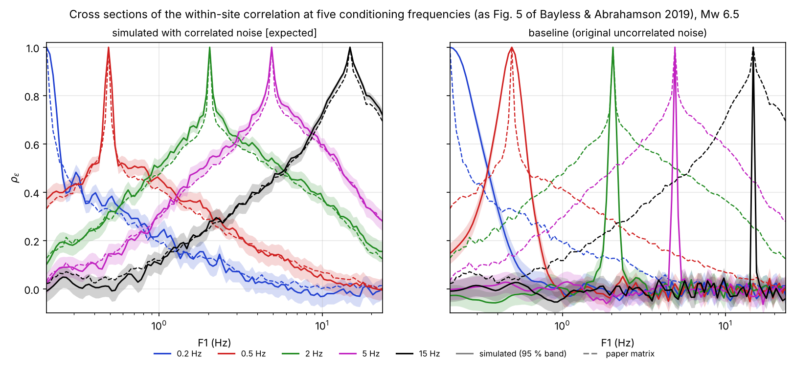
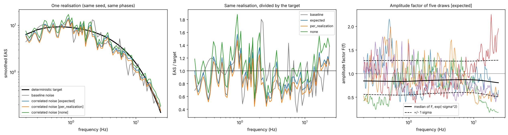

# stochastic_gm

Stochastic ground-motion simulator based on the Boore (2003) stochastic
method, extended to multi-component **(P, SV, SH)** output for point-source
and finite-fault models by Otarola et al (2016, 2018) and latter modified by Alvarez 2022.

---

## Package layout

```
stochastic_gm/                  ← repository root
│
├── setup.py
├── requirements.txt
├── README.md
├── tools/
│   └── build_ba19_data.py               ← regenerates stochastic_gm/ba19_data.py (developer tool)
├── examples/                   ← usage examples
│   ├── run_simulation_exemple.py        ← point-source simulation
│   ├── run_finite_fault.py              ← finite-fault simulation (dict-based)
│   └── lebanon_faille.csv               ← example fault model used by run_finite_fault.py
│
└── stochastic_gm/              ← importable package
    ├── __init__.py             ← public API (EQ, configs, physics helpers)
    ├── config.py               ← typed dataclass configurations
    ├── earthquake.py           ← EQ orchestrator class
    ├── point_source.py         ← PointSource spectral engine
    ├── physics.py              ← stateless numerical functions
    ├── correlated_noise.py     ← optional interfrequency-correlated noise (Bayless & Abrahamson 2019)
    ├── ba19_data.py            ← bundled correlation matrices and sigma coefficients (generated)
    └── verification/
        ├── __init__.py
        ├── point_source_validation.py            ← point-source verification suite
        ├── verify_interfrequency_correlation.py  ← recovers the correlation structure of the paper
        └── verify_noise_scaled_spectra.py        ← deterministic spectrum vs noise-scaled spectra
```

---

## Installation

### Requirements

- Python >= 3.8
- numpy >= 1.21
- scipy >= 1.7
- numba >= 0.55
- matplotlib >= 3.4 *(only needed for the example scripts)*
- pandas *(only needed for the example scripts)*

Install all dependencies at once:

```bash
pip install -r requirements.txt
```

### Install the package

Clone the repository and install in editable mode (recommended during development — any edit to the source is immediately reflected without re-installing):

```bash
git clone https://github.com/YOUR_USERNAME/stochastic_gm.git
cd stochastic_gm
pip install -e .
```

Or install without cloning:

```bash
pip install .
```

---

## Getting started

Two ready-to-run example scripts are included at the root of the repository:

| Script | Description |
|---|---|
| `examples/run_simulation_exemple.py` | Point-source simulation — the simplest starting point |
| `examples/run_finite_fault.py` | Finite-fault simulation — loads `lebanon_faille.csv` and runs a full finite-fault simulation |

Run either script directly after installing the package:

```bash
python examples/run_simulation_exemple.py   # point-source
python examples/run_finite_fault.py         # finite-fault
```

Both scripts are fully annotated and cover the complete workflow: configuring the medium, source, path, site, and simulation parameters, running `EQ`, and plotting the output waveforms. The finite-fault script reads `examples/lebanon_faille.csv`, a semicolon-separated file with columns `lon`, `lat`, `depth` (m), `slip` (m), `rupture` (s), `dip` (deg), and `rake` (deg), one row per fault patch.

A validation suite for the point-source engine is also available as a module:

```bash
python -m stochastic_gm.verification.point_source_validation --Vp 6.0 --Vs 3.46 --depth 15 --dist 30 --Mw 6.0 --sd 50 --show
```

---

## Finite-fault mode

In finite-fault mode the rupture is discretised into a list of sub-sources, each described by a plain Python dict. The tool handles moment partitioning, activation ordering, and coordinate conversion internally — you only need to supply the geometry and kinematics.

### Minimal example

```python
import numpy as np
from stochastic_gm import (
    EQ,
    MediumConfig, SourceConfig, PathConfig,
    SiteConfig, DurationConfig, SimConfig,
)

medium   = MediumConfig(
    system = 'local',
    Depth  = np.array([0., 30.]),
    vs     = np.array([3.46, 3.46]),
    vp     = np.array([6.00, 6.00]),
    Rho    = np.array([2.7,  2.7]),
)
source   = SourceConfig(stress_drop=50., rake=90., dip=45.)
path     = PathConfig(Qo=300., Q1=0., Q1exp=0., R0=1., R1=100., b1=1., R2=200., b2=0.5, b3=0.)
site     = SiteConfig(amp_freq=np.array([0.01, 200.]), amp=np.array([1.0, 1.0]))
duration = DurationConfig(path_duration=0.05)
sim      = SimConfig(dt=0.01, n_sim=1, seed=42,
                     epsilon_s=0.2, nu_s=0.05, ftgm_s=0.5,
                     epsilon_p=0.2, nu_p=0.05, ftgm_p=0.5)

# Three sub-sources along a simple fault — local Cartesian coordinates [x, y, depth] in km
subsource_list = [
    {'centroid': [ 0., 0., 12.], 'slip': 1.5, 'rupt_t': 0.0},
    {'centroid': [ 5., 0., 13.], 'slip': 2.8, 'rupt_t': 0.9},
    {'centroid': [10., 0., 14.], 'slip': 1.1, 'rupt_t': 1.8},
]

eq = EQ(
    Mw             = 6.5,
    medium         = medium,
    source         = source,
    path           = path,
    site_cfg       = site,
    duration       = duration,
    sim            = sim,
    hypocenter     = [0., 0., 12.],   # km — local coordinates
    site_coord     = [30., 0.,  0.],  # km
    point_source   = False,
    subsource_list = subsource_list,
)

NS, EW, UD = eq.sim_acc[0]
print(f"PGA_NS = {max(abs(NS)):.3f} cm/s²")
```

### Enabling finite-fault mode

Set `point_source=False` and pass `subsource_list` to `EQ`:

```python
eq = EQ(
    Mw             = 7.0,
    medium         = medium,
    source         = source,
    path           = path,
    site_cfg       = site_cfg,
    duration       = duration,
    sim            = sim,
    hypocenter     = hypocenter,
    site_coord     = site_coord,
    point_source   = False,        # ← switch to finite-fault
    subsource_list = subsource_list,
)
```

### Sub-source dict format

Each dict in `subsource_list` represents one fault patch:

```python
{
    'centroid': [lon, lat, depth_km],  # patch centre — geographic [lon, lat, depth_km]
                                       # or local Cartesian [x_km, y_km, z_km]
                                       # (controlled by MediumConfig.system)
    'slip'    :  slip_m,               # slip [m] — used to weight seismic moment
    'rupt_t'  :  rupture_time_s,       # rupture arrival time at this patch [s]

    # Optional — override the global values set in SourceConfig:
    'dip'     :  dip_deg,              # per-patch dip  [deg]
    'rake'    :  rake_deg,             # per-patch rake [deg]
    'sd'      :  stress_drop_bar,      # per-patch stress drop [bar]
}
```

Patches with zero slip are ignored internally. Seismic moment is distributed proportionally to slip, so only relative slip values matter. Activation order is derived automatically from `rupt_t`.

### Coordinate system

The coordinate system for `centroid`, `hypocenter`, and `site_coord` is set once via `MediumConfig.system`:

- `'geographic'` — pass `[longitude, latitude, depth_km]`; the tool converts to local Cartesian internally using the hypocenter as origin.
- `'local'` — pass `[x_km, y_km, z_km]` directly; no conversion is applied.

### Building the subsource list from a CSV

A common workflow is to load a kinematic rupture model from a CSV file:

```python
import pandas as pd

df = pd.read_csv('fault_model.csv', sep=';')
df = df[df['slip'] > 0].reset_index(drop=True)  # drop zero-slip patches

subsource_list = [
    {
        'centroid': [row['lon'], row['lat'], row['depth'] / 1000.],  # m → km
        'slip'    :  row['slip'],      # m
        'rupt_t'  :  row['rupture'],   # s
        'dip'     :  row['dip'],       # deg
        'rake'    :  row['rake'],      # deg
    }
    for _, row in df.iterrows()
]
```

A fully annotated version of this workflow, including result plotting and sanity checks, is provided in `examples/run_finite_fault.py`.


## Interfrequency-correlated noise (optional)

By default the amplitude of the windowed white noise is random and uncorrelated between
frequencies, so the simulated Fourier amplitude spectra have almost no interfrequency
correlation of epsilon (the correlation of the log-amplitude residuals), unlike recorded
motions. The package can replace that amplitude by a log-normal factor whose correlation
and standard deviation follow Bayless & Abrahamson (2019); the noise phases are kept.

```python
from stochastic_gm import SimConfig, CorrelatedNoiseConfig

sim = SimConfig(dt=0.01, n_sim=100, seed=1, ...,
                corr_noise=CorrelatedNoiseConfig())      # defaults below
```

Leaving `corr_noise` unset (`None`) keeps the standard uncorrelated noise.

| Option | Values | Meaning |
|---|---|---|
| `correlation_type` | `'within_site'` (default), `'total'`, `'between_site'`, `'custom'` | Which matrix of the paper. Within-site is the variability of the noise alone for a fixed scenario and site; `total` also contains between-event and between-site terms. `'custom'` takes `custom=(freqs, matrix, sigma_freqs, sigma)`. |
| `normalization` | `'expected'` (default), `'per_realization'`, `'none'` | `expected`: ln F = sigma*eps - sigma^2, so E[F^2] = 1 (rms level of the deterministic spectrum kept on average). `per_realization`: each draw divided by the rms of its F (Boore style). `none`: ln F = sigma*eps. |
| `apply_to` | `'horizontal'` (default), `'all'` | Horizontal components only, or the same epsilon on the vertical too. |
| `mw` | float or `None` | Magnitude for sigma(Mw); `None` uses the earthquake's Mw. |
| `sigma` | float or `None` | Constant ln standard deviation instead of the BA18 values. |

The standard deviations (tau, phi_S2S, phi_ss and the total) are those of the BA18 EAS
model and depend on magnitude (interpolated between M 4 and 6). The matrices cover
0.1-24 Hz; values are held outside that band. The between-event matrix is not bundled.

**Finite fault (post-processing).** A correlated epsilon drawn per sub-source does not survive the summation
(the sum is smoother and its variance is reduced; `EQ` warns if you set `corr_noise` on a finite fault). Instead,
leave `corr_noise=None` and impose one epsilon on the summed record with `stochastic_gm.postprocess`:

```python
from stochastic_gm import CorrelatedNoiseConfig, postprocess_eq

eq.run_simulation()                       # finite fault, independent noise per sub-source
cfg = CorrelatedNoiseConfig(correlation_type='within_site', normalization='expected')
acc = postprocess_eq(eq, cfg, seed=7)     # list of (NS, EW, UD); eq.sim_acc is not modified
```

Each record is rescaled to its own Konno-Ohmachi smoothed spectrum (`smoothing_b`, default 10), the BA19 residual
(one epsilon per record, the same on NS and EW; UD only with `apply_to='all'`) is imposed with the phases kept
(`mode='replace'`, default) or multiplied on top of the record's own scatter (`mode='scale'`). It also works on
any list of (NS, EW, UD) records through `postprocess_records(records, dt, cfg, Mw=...)`. See
[`stochastic_gm/verification/README.md`](stochastic_gm/verification/README.md) (test 5).

### P/S noise independence

`SimConfig(independent_ps_noise=True)` (default) uses independent white noise for the P and S waves of each
sub-source. `False` reproduces the earlier behaviour (one shared sequence), which loses energy when the P and S
windows overlap. Both are kept so the effect can be used in sensitivity analyses.

### Verification

All tests are described in [`stochastic_gm/verification/README.md`](stochastic_gm/verification/README.md).

```bash
python -m stochastic_gm.verification.verify_interfrequency_correlation --n-sim 2000
python -m stochastic_gm.verification.verify_noise_scaled_spectra --n-sim 1000
python -m stochastic_gm.verification.verify_rvt --n-sim 100
python -m stochastic_gm.verification.verify_gmpe_ab06 --n-sim 60     # needs: pip install pygmm
python -m stochastic_gm.verification.verify_finite_fault_postprocess --n-sim 800   # ~10 min
python -m stochastic_gm.verification.verify_azimuth                                # ~10 s
```

The first simulates many realizations, computes the Konno-Ohmachi smoothed EAS and
recovers the correlation structure (cross sections like Fig. 5 of the paper, contours,
sigma). The second shows the deterministic spectrum, the spectrum scaled by the original
noise and by the correlated noise, and the amplitude factor applied.

Within-site correlation recovered from 2000 simulated realizations (left: with correlated
noise; right: original noise), against the matrix of Bayless & Abrahamson (2019):



One realization: deterministic target, original noise, correlated noise, and the amplitude
factor applied:



### Noise normalization

The simulated Fourier amplitude spectrum has the deterministic spectrum as its rms
level, independent of `dt` and of the record length (`scale_spectrum` divides the unit-rms
noise spectrum by `sqrt(N) * dt`). Earlier versions scaled the amplitudes by
`sqrt(N) * dt / 2` instead, which made the amplitudes depend on `dt`.

---

## Unit conventions

| Quantity       | Unit       |
|----------------|------------|
| Velocities     | km/s       |
| Depths/distances | km       |
| Seismic moment | dyne·cm    |
| Stress drop    | bar        |
| Frequency      | Hz         |
| Time           | s          |
| Acceleration   | cm/s²      |

---

## References

- Boore D.M. (2003). Simulation of ground motion using the stochastic method.
  *Pure Appl. Geophys.* 160, 635–676.
- Brune J.N. (1970). Tectonic stress and spectra of seismic shear waves.
  *J. Geophys. Res.* 75, 4997–5009.
- Motazedian D. & Atkinson G.M. (2005). Stochastic finite-fault modelling
  based on a dynamic corner frequency. *Bull. Seismol. Soc. Am.* 95, 995–1010.
- Dang et al. (2021). Updated corner-frequency model for stochastic
  finite-fault ground-motion simulation.
  *Bull. Seismol. Soc. Am.* 112, 921–938.
- Otarola C. & Ruiz S. (2016). Stochastic generation of accelerograms for subduction earthquakes.
  *Bull. Seismol. Soc. Am.* 106(6), 2511–2520. https://doi.org/10.1785/0120150262
- Ruiz S., Ojeda J., Pastén C., Otarola C. & Silva R. (2018). Stochastic strong-motion simulation in
  borehole and on surface for the 2011 Mw 9.0 Tohoku-Oki megathrust earthquake considering P, SV, and SH
  amplification transfer functions. *Bull. Seismol. Soc. Am.* 108(5A), 2333–2346.
  https://doi.org/10.1785/0120170342
- Bayless J. & Abrahamson N.A. (2019). An empirical model for the interfrequency correlation of
  epsilon for Fourier amplitude spectra. *Bull. Seismol. Soc. Am.* 109(3).
  https://doi.org/10.1785/0120180238
- Bayless J. & Abrahamson N.A. (2018). Evaluation of the interperiod correlation of ground-motion
  simulations. *Bull. Seismol. Soc. Am.* 108(6), 3413–3430. https://doi.org/10.1785/0120180095
- Bayless J. & Abrahamson N.A. (2018). An empirical model for Fourier amplitude spectra using the
  NGA-West2 database. PEER Report 2018/07.
